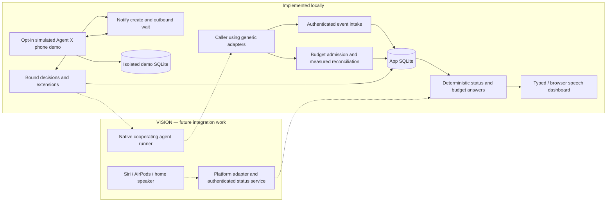

# SpeakSeek

**Know what your agent last reported. Approve its next bounded step. Give each task a token allowance you can explicitly extend.**

Agents keep working while their owners cook dinner, take a walk, or switch projects. The owner still needs two answers: **“Where is this task, and what decision does it need?”** and **“How much more token use have I allowed?”** SpeakSeek brings those questions together without treating silence as progress or a vague yes as unlimited permission.

**Agent X is a name for a task or agent, not the X social network.** The product vision is voice access from Siri/AirPods or a home speaker, backed by authenticated evidence and precise phone decisions. The current local MVP supplies the event record, deterministic answers, cooperative token gate, and bound Notify approval flows. Native voice-assistant queries and agent-control integrations remain future work.

**A real slice has been observed:** on November 7, 2026 (CST), the owner heard a real Notify request through AirPods Pro, then opened Notify and **tapped Approve**. A matching approval changed an isolated **SIMULATED** allowance from 10,000 to 20,000 once. That is announcement plus **TOUCH approval**, not voice approval or real provider spending. [Evidence and limits](#evidence-and-limits) separate this result from the wider vision.

[Product story](PRODUCT.md) · [Safe demos](DEMO.md) · [Capability matrix](#capability-matrix) · [Setup](#setup) · [Budget math](#budget-math)

## Two pillars

### 1. Know, decide, continue

Ask about a named task and hear its last observed state, current reported work or blocker, timestamp, source, freshness, and pending decisions. When a specific action needs permission, the intended workflow sends an exact action-bound Notify prompt. A confirmed approval permits only that action; an integrated cooperating runner can continue and report new evidence. Ask again to hear what changed.

The local dashboard and authenticated event adapters already provide recorded status and questions. Browser push-to-talk and read-aloud are implemented but microphone/audio behavior has not been verified. A Siri or speaker front door, native agent runner, and automatic pause/resume connection are **vision**, not installed connectors. The timestamp demo writes one file; it does not resume a coding agent.

### 2. Bound usage, then explicitly extend

Allocate an absolute allowance, such as 10,000 tokens, or a percentage of an explicitly declared daily token pool. A cooperating adapter must reserve a conservative operation maximum **before** starting it, then reconcile measured usage. If that maximum cannot fit safely, admission is refused. The owner can request a bounded extension; exact phone confirmation changes the allowance once.

The cooperative ledger/gate and separate extension decisions are implemented locally. They do not impose a provider-native quota or forcibly stop an unintegrated agent. Voice requests for a new amount remain **vision**. The current extension control takes an absolute extra-token amount; the isolated real-phone demo is fixed at +10,000, new total 20,000.

### Vision conversation: status to decision to a new status

> **VISION — hypothetical dialogue, not runnable commands.** Example times are UTC. Siri status queries and the runner described below are not implemented.
>
> **Owner, through Siri/AirPods:** “How is Agent X's checkout task doing?”
>
> **Intended SpeakSeek reply:** “The checkout adapter reported checks passing at 18:42 UTC, one minute ago. It is waiting for permission to run the next named validation step for revision R7. No completion event is recorded.”
>
> **Owner:** “Send that decision to my phone.”
>
> **Notify prompt:** “Agent X, revision R7: allow this validation step only, with these fixed parameters and expiry?” The task/action, parameter hash, nonce, and expiry identify one request.
>
> **Owner taps Approve.** A future integrated runner verifies that exact decision, executes only the bounded step while retaining its normal safeguards, and emits a new event.
>
> **Owner, later:** “What changed?”
>
> **Intended reply:** “At 18:44 UTC the adapter reported that validation passed. The task itself has no recorded completion yet. A different step requires a different decision.”
>
> If the latest evidence is stale, the reply instead says when it was last observed and that current progress is unknown. A voice answer itself never authorizes execution.

### Vision conversation: a cap is not a completion estimate

> **VISION — hypothetical dialogue, not a spoken input feature.** Assume a fresh adapter report and an owner-declared 100,000-token daily denominator for the explicit UTC window in [budget math](#budget-math).
>
> **Intended notice:** “Agent X reached its 10,000-token allowance. The adapter separately reported an estimated 25% of the work complete at 18:50 UTC. Further cooperative admission is blocked.”
>
> **Owner, through a home speaker:** “Add 5% of my daily token pool.”
>
> **Intended reply:** “For your declared 100,000-token pool, that adds 5,000 tokens: task allowance 10,000 → total 15,000. That is five percentage points of the daily pool, and a 50% increase of this task's allowance. I'll request confirmation for that exact change.”
>
> **Bound phone prompt:** “Agent X, this budget version: add exactly 5,000 tokens, resulting total 15,000, once before expiry?”
>
> **Owner explicitly approves.** A cooperating adapter may admit a next operation only if it fits and fresh accounting and other holds also permit it.
>
> **Owner:** “Does that mean it is 50% done?”
>
> **Intended reply:** “No. The last reported work estimate is still 25% until the agent updates it. Token consumption and work completion measure different things.”

The **25% work estimate is hypothetical and usable only if the agent actually reports it**, with source and time. There is no new completion-percentage field or seeded progress claim. If progress is missing or stale, the answer must say so. Google Home, HomePod, Alexa, and native Siri amount requests in this dialogue are not built.

## Evidence and limits

### Owner-confirmed manual result

On **November 7, 2026 (CST)**, one real Notify request was accepted and a matching bound approval was confirmed. The owner reports that AirPods Pro Siri asked whether to read the notification; the owner said to read it and heard the announcement. The owner **then opened Notify and tapped Approve**.

| Recorded element | Observed scope |
| --- | --- |
| Request and response | Real Notify transport and confirmed bound approval; final `CONSUMED`, `approvalConfirmed: true`, exit 0 |
| Ledger | Isolated simulated agent: 10,000 used; allowance 10,000 → 20,000 exactly once; remaining 10,000; version 1 → 2 |
| Audio and decision | Owner-confirmed AirPods announcement, followed by Notify **touch** approval |
| Earlier attempts | Two timed-out attempts left the allowance unchanged; no old invocation should be replayed |
| Not demonstrated | Siri usage query, spoken approval, spoken amount parsing, real token spend, real agent pause/resume, or browser microphone |

No model was invoked and no paid model tokens were used in this demo. This observation establishes one device/account flow, not universal announcement/reply eligibility. Every new run still needs its own owner confirmation; a CLI receipt alone cannot prove delivery or audio.

### Capability matrix

“Implemented locally” describes this checkout, not a released integration. Automated mock tests are evidence, not an independent security audit.

| Capability | Local implementation / automated evidence | Manual evidence or pending work |
| --- | --- | --- |
| Per-session SQLite events, ordering, duplicate handling, fresh/stale/unknown status | Implemented; handler/domain tests | Native live agent telemetry still requires an actual adapter |
| Typed and speech-transcript status/budget questions | Deterministic, read-only local answers; tested with mocks/handlers. This cloud run’s browser smoke submitted typed questions | Microphone capture and audible read-aloud were not exercised |
| Per-task allowances and atomic checkpoint/reserve/reconcile/uncertain gate | Implemented; boundary, accounting, restart and concurrent-admission tests | Provider-specific tokenizer/cap adapters not verified |
| Normal task-budget phone extensions | Separate bound gate; denial/expiry/replay/error and atomic-application tests | Real provider/agent continuation not demonstrated |
| Isolated simulated-agent / real-phone demo | Implemented; 47 tests in `phone-demo.test.js`, counted inside this run’s 163 passing tests | Real Notify + AirPods announcement + **touch** approval confirmed as above. This cloud run did not send a Notify request |
| Generic fixed timestamp-file gate | Implemented and separately tested | Not the demonstrated budget extension; does not resume agents |
| Generic samples and simulated decisions/extensions | Offline, clearly labeled; never authorize live tasks or send real pushes | Sample figures are not real usage |
| Optional Belweave/Kai-4 evidence selection | Implemented; failures fall back deterministically; automated requests mocked | No live model verification is established by the phone demo |
| Generic event CLI and limited Cursor `stop` hook | Implemented, documented payload fixture tested | Actual Cursor invocation unverified; no native Codex/Grok Bot connector |
| Siri/AirPods status queries, spoken amounts or approve actions | **VISION** | Native/provider capability, authenticated integration and device verification required |
| Google Home, HomePod, Alexa; custom microphone gesture/wake word | **VISION** | No connectors, native bridge, or “Hey Agent X” implementation |
| Universal external-agent stop/resume; hosted service | **Not implemented** | Local source is not a deployed service |

## Architecture



Dashed edges are vision, **not remote access to the current loopback backend**. Native platforms need supported APIs/Intents or service work, authenticated access, precise confirmation and replay protection, and device testing. Missing hardware is not the sole remaining task. The current headless Notify flow uses ordinary outbound requests; no inbound relay or backend exposure is needed or permitted as a workaround.

## Budget math

**Example, not a discovered quota:** the owner declares **100,000 tokens** for **2026-11-08T00:00:00.000Z → 2026-11-09T00:00:00.000Z**, a 24-hour **UTC** window. Usage is measured separately by a cooperating adapter; the denominator is owner-declared. A real setup must supply its own valid current window and truthful counts.

| Request or measurement | Token math | Meaning |
| --- | --- | --- |
| Allocate 10% of that daily pool | 100,000 × 0.10 = 10,000 | Initial task allowance |
| Add 5% of that daily pool | +5,000 → total 15,000 | Daily share 10% → 15%: **+5 percentage points**, **+50% relative task increase** |
| Add five percentage points of the same daily pool | +5,000 → total 15,000 | Same result only while the denominator stays 100,000 |
| Increase the 10,000 task allowance by 5% relatively | +500 → total 10,500 | A different request; not +5,000 |
| Measure 5,000 tokens used against the initial allowance | 5% of daily pool; 50% of task allowance | Says nothing about work completion |

Initial allocations accept 1–1,000,000,000 absolute tokens or a daily percentage of 0.01–100 with at most two decimals. Daily mode requires an explicit token denominator and valid 24-hour ISO UTC period containing the current time. Conversion floors to whole tokens and rejects an allocation below one token. Credits/subscription branding are not token denominators. There is no quota autodiscovery, shared-pool enforcement, or automatic renewal/reset when the window expires.

### Why an operation can be refused

- **Measured exhaustion:** used tokens reach/exceed the allowance. The state and one deduplicated exhaustion alert intent per version persist. Real alerts are optional and samples suppress them.
- **Insufficient headroom:** with 8,835 used of 10,000 and no holds, 1,165 remains; a proposed 2,000-token maximum does not fit. That operation is refused even though the cap is not exhausted. A smaller bounded operation might fit.
- **In flight:** outstanding reservations hold their whole maxima until measured reconciliation. Fully reserved is different from measured exhaustion.
- **Unknown/stale usage:** no baseline or evidence older than 120 seconds blocks new strict admission; missing spend is not zero.
- **Uncertainty/other holds:** interrupted or overdue reservations keep their bounds; regressions, bound violations, expired daily periods and version changes can block work independently.

Allocation alone does not grant admission. Normal accounting calls require the ingest token and matching session agent. A cumulative checkpoint cannot overlap outstanding operations; operation reconciliations are additive/idempotent. Input includes cached input, output includes reasoning output, and `total = input + output`; inclusive subsets are validated rather than added twice. Unknown optional detail stays unknown.

The [budget adapter](scripts/budget-adapter.mjs) reserves before invoking a cooperating callback and requires measured reconciliation. It trusts the integrator to scope usage correctly, conservatively bound all input, and actually enforce a supported inclusive output/reasoning cap. No universal tokenizer/provider-cap adapter is verified. Actual excess is recorded and further admission fails closed; already spent/in-flight tokens cannot be reclaimed. Agents that ignore this gate are **monitoring-only**. No external Codex, Grok Bot, or Cursor process is forcibly stopped by a dashboard flag.

A real extension is a separate bound decision for one task/version and exact extra token amount. The isolated demo additionally fixes and hashes the original and resulting totals. Confirmed approval applies once atomically; denials, errors, expiry, timeout, malformed/late replies and replay do not resume permission. Approval does not clear stale data, uncertainty, bound violations or other holds, and it never substitutes for normal tool/OS safeguards.

## Illustrative applications

These are possible uses of the foundation, **not shipped integrations or claimed customer outcomes**.

| Task | Useful evidence and decision | Integration still needed |
| --- | --- | --- |
| Coding task | Last checks, blocker, reviewed next validation step, per-task token headroom | Actual agent telemetry, verified caps, bounded runner action |
| Research agent | Which sources were processed, where review is needed, bounded follow-up allowance | Research adapter and truthful scoped usage; no automatic correctness guarantee |
| Long-running data job | Reported batches/results, a retry decision, token limits for model-using steps | Job adapter; token budgeting does not cap CPU/storage spend |
| Multiple agents | Separate session ledgers, specific approvals and budget versions | Per-agent cooperation and orchestration; no shared provider-pool enforcement |

## Setup

Run from this project root using **Node 24.22.1+**. Runtime/build use Node's SQLite and TypeScript transformation, with no runtime npm dependencies. The visible product is SpeakSeek. It was built for Notify Weekend 01 on [justship.dev](https://justship.dev/notify-weekend-1). The legacy `agentpulse` package, `AGENTPULSE_*` variables, SQLite filename and browser CSRF identifier remain compatible with the original MVP.

```bash
npm run build
```

For the default **offline, mocked, model-off demonstration**, use [DEMO.md](DEMO.md#offline-terminal-demo). A local dashboard can run with `npm start` where normal loopback permissions allow it; prefer the [offline preview profile](DEMO.md#offline-dashboard-walkthrough) during a demo. Ordinary startup can check Notify authentication. Keep all security/permission settings; do not work around a blocked browser/socket with a tunnel or changed bind.

The server listens only on `127.0.0.1`, preferring `http://127.0.0.1:5177`, then 5178–5190 if occupied. Use the printed URL, stop with Ctrl+C, and restart with `npm start`. No hosted URL is claimed. SQLite persists in `.local/agentpulse.sqlite`; samples seed once, age naturally, and are not reset by restarting.

| Command | Existing behavior |
| --- | --- |
| `npm run dev` / `npm start` | Rebuild/watch local source / run the production build |
| `npm run build` | Compile server/UI/tests using Node transform; not a static typecheck |
| `npm run typecheck` | Strict TypeScript check. It needs the development TypeScript dependency. The November 7 Codex record did not have `tsc`; this pull request’s cloud check did |
| `npm test` | Build, then run every `dist/tests/*.test.js` file, including loopback HTTP and child-process transport checks. Model and Notify calls in tests are mocks |
| `npm run seed` | Seed/preserve sample sessions and the simulated token fixture |
| `npm run report-event` | Read one authenticated event JSON from stdin |
| `npm run budget-adapter -- ACTION SESSION_ID` | Existing `checkpoint`, `reserve`, `reconcile`, `uncertain` actions; JSON on stdin |
| `npm run demo:phone -- --help` | Help only, no state or network |

Development typecheck and browser dependencies are listed in [package.json](package.json). `npm install` is for those tools only. This pull request’s cloud check installed them and ran `npm run smoke:browser` against loopback with the model key empty and Notify pointed at an absent executable. `npm run smoke:model` was not run. Neither script is part of the default offline demo, and neither sends a phone request.

### Configuration and security

[.env.example](.env.example) has placeholders only. Keep actual values in the inherited environment or ignored local configuration, never in docs, assets, fixtures, logs or chat.

| Name | Purpose/default |
| --- | --- |
| `AGENTPULSE_INGEST_TOKEN` | Event/accounting bearer secret, at least 32 characters; otherwise generated locally with mode 0600 |
| `AGENTPULSE_PORT` | Preferred loopback port, default 5177 |
| `AGENTPULSE_URL` | Local adapter target, default `http://127.0.0.1:5177` |
| `AGENTPULSE_NOTIFICATIONS` | Optional real alerts; default false. A saved dashboard preference persists and can override the environment fallback |
| `NOTIFY_BIN` | Normal Notify CLI executable, default `notify` on PATH |
| `NOTIFY_TOKEN`, `NOTIFY_API_URL` | Optional normal Notify CLI environment settings; the CLI owns credential handling |
| `BELWEAVE_API_KEY` | Optional server-side inference key; unnecessary for deterministic answers or the headless phone demo |
| `BELWEAVE_BASE_URL`, `BELWEAVE_MODEL` | Defaults `https://api.infer.belweave.ai/v1`, `Belweave/Kai-4` |
| `CHROME_BIN` | Optional browser-tool executable; browser smoke is separate authorized work, not an offline demo step |

The owner's manual test used an installed, authenticated Notify CLI. Other users need their own normally authorized CLI/phone installation, same account, and notification permission; see the [Notify quickstart](https://notify.belweave.ai/docs/quickstart). Do not infer every installation is configured, inspect credential files, auto-run login, or send a test push just to discover configuration.

Host/Origin and cross-site checks, HttpOnly SameSite cookie plus CSRF on browser mutations, bearer-authenticated intake, payload/schema limits, text escaping/CSP, loopback binding, heuristic redaction and session isolation remain intact. Redaction is not a guarantee against secrets submitted by producers: send short outcomes, not commands, paths or file contents.

### Existing evidence and adapter contracts

The [event store](src/store.ts) accepts exactly seven JSON keys: `agentId`, `sessionId`, `eventId`, `type`, UTC `timestamp`, nonnegative `sequence`, and short `summary`; see the [adapter example](DEMO.md#adapter-examples). Highest sequence controls the observed state; duplicate same-content replays are idempotent, changed replays conflict. Events over 120 seconds ahead are rejected; freshness uses the earlier of event and receipt times. Old/replayed evidence does not become progress. A stored completion is a recorded claim, not an independent inspection.

Configured budget sessions and budget questions use a read-only deterministic ledger answer without model or Notify calls. Other status questions retain deterministic fallback; optional Belweave/Kai-4 can only select supplied sanitized evidence (512-token output budget, 20-second timeout), not invent status, run tools or approve actions. Browser speech is feature-detected, review-before-submit, and typing survives microphone denial. Recognition may use a browser-vendor service; it is not part of a guaranteed offline demo.

A [generic event adapter](scripts/report-event.mjs) and a [limited Cursor stop-hook example](scripts/cursor-hooks.example.json) exist. The [Cursor reference](https://cursor.com/docs/agent/hooks) defines the stop fields used by the fixture. This records loop outcomes by generation, not proven task completion or full telemetry. Its actual execution in Cursor is unverified. No automatic native Codex/Grok Bot integration is claimed.

Completion, failure, decision and measured budget-exhaustion alerts are explicit opt-ins, deduplicated and rate-limited. A refused operation does not automatically create every kind of phone request; the integrating caller/owner must explicitly request an extension. Generic samples never send. The fixed timestamp gate remains a separate one-file action; the [isolated phone demo](DEMO.md#optional-real-phone-test) changes only its own simulated budget. Neither is arbitrary command approval or native agent resume.

## Verification and source status

These documents describe the source in **this pull request**, including the token-budget ledger and the isolated headless phone demo. They do not mean [GitHub `main`](https://github.com/Studyd-tech/speakSeek) already contains that source. When this branch was cut, `main` was `4b28691ac86b235d5376bfc3aeec76546aa61818`. Merging is a separate review step. Source publication is not a hosted service. Older archives, where present, predate the token-budget and headless-phone additions and were not rebuilt.

### Inherited evidence

[VERIFICATION.md](VERIFICATION.md) is the dated November 7, 2026 record. It keeps the Codex sandbox notes (48 passed, 2 skipped, typecheck and server blocked in that sandbox) and a separate checkout note of **50 passed, 0 skipped**, typecheck, and loopback HTTP on the earlier MVP. Those figures describe that earlier source. The published import identified its Codex source archive `agentpulse-source.tar.gz` as SHA-256 `0099603f418ca57de97efb1ac7e4472eb4ceaba8a81d2bf9edde94fd15fc0e7f` and a comparison production archive as SHA-256 `8fa85da4e1a7f5f8417005114900b602ea65f8d3a051b1de7219400e71a78170`. Those archives predate this pull request and were not rebuilt.

A prior local preflight of this expanded tree reported **161 available tests passed, including 47 phone-demo tests**, with two transport checks **pre-excluded** and `tsc` unavailable. That preflight is a baseline only. It is not the result below.

Owner-confirmed manual result, **November 7, 2026 (CST):** AirPods Pro announced one real Notify request; the owner then opened Notify and tapped Approve. An isolated simulated allowance changed from 10,000 to 20,000 once. Simulated usage stayed 10,000. No model tokens were spent, and no external agent continued. That is announcement plus touch approval, not spoken approval.

### This cloud environment — November 8, 2026

Node **v24.22.2**. No live Notify push, model call, deployment, or tunnel. The server used an empty model key and a Notify executable path that does not exist.

| Check | Command and result |
| --- | --- |
| Static typecheck | `npm run typecheck` at 2026-11-08T17:56:57Z. **Passed.** `tsc --noEmit`. One imported annotation had typed Notify’s exit code as a string; the existing numeric-or-string cast was restored so exit code 3 still type-checks. This is not the November 7 Codex environment |
| Production build | `npm run build` inside `npm test`. **Passed** via Node’s TypeScript transform, with the experimental-transform warning. Transformation is not the typecheck above |
| Full automated tests | `npm test` started 2026-11-08T17:56:59Z. **163 passed, 0 failed, 0 skipped**, about 1.6s. The 47 `phone-demo.test.js` tests are included in the 163, not added on top. The previously pre-excluded loopback HTTP test and `execFile` transport test both **passed** here |
| Loopback HTTP | `GET /` and `GET /api/health` at 2026-11-08T17:57:24Z returned **200**. Health: SQLite, Belweave unconfigured, Notify “CLI not installed.” Homepage included SpeakSeek and the budget section and did not include the ingest token |
| Browser smoke | `npm run smoke:browser` at 2026-11-08T17:58:52Z. **Passed** on desktop 1440×1100 and mobile 390×844: seeded ledger question, ask-budget, one simulated +1,000 extension to 11,000, simulated timestamp approve/deny/timeout, mocked real-gate error, and an unbudgeted session still using stored-event fallback. No microphone or audible playback |

Mocked approval tests, this browser smoke, and the November 7 touch approval are separate evidence. These checks are not a security audit.

## Roadmap

1. **Cooperating agent/provider adapters:** truthful task telemetry, verified tokenizer/overhead bounds and inclusive caps, measured reconciliation, and a narrow runner action contract. No universal stop promise.
2. **Voice status service:** a supported Siri/iPhone or speaker front door with authenticated access and privacy controls, separate from the current loopback UI.
3. **Voice proposals and confirmation:** documented provider/native reply support before accepting an amount proposal; exact bound confirmation and replay controls before any extension/action. Spoken text alone remains insufficient.
4. **Platform and device work:** Siri/Shortcuts/App Intents or supported platform/service capabilities, and Google Home/HomePod/Alexa integrations only after API, authentication, permissions and device testing. Announcement evidence does not implement these connectors.
5. **Optional hosting:** a future hosted service needs its own authenticated backend and persistent storage. No backend exposure workaround is part of this MVP. This pull request publishes source for review; it does not deploy that service.
