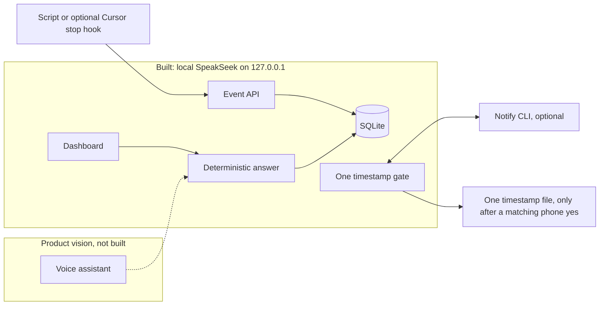

# SpeakSeek

**Ask your coding agent how it's doing. Approve exactly one bounded action from your phone. Get back to your life.**

**Product story:** [PRODUCT.md](PRODUCT.md) is the same vision in plain language. This README is the piece a judge can read alone.

SpeakSeek is a status and approval layer for a coding task you already named. It keeps a durable, timestamped record of what that task has actually reported. It answers spoken or typed questions only from that record. When a human decision is needed, Notify is the phone channel for one precise, one-time approval. The official setup is the [Notify quickstart](https://notify.belweave.ai/docs/quickstart).

It was built for **Notify Weekend 01** on [justship.dev](https://justship.dev/notify-weekend-1). The visible name is SpeakSeek. The imported application was built as AgentPulse. Runtime identifiers stay as they were (`agentpulse` package, `AGENTPULSE_*` variables, the SQLite filename, and the browser CSRF header).

**Source provenance:** the application is the Codex allowlisted archive `agentpulse-source.tar.gz`, SHA-256 `0099603f418ca57de97efb1ac7e4472eb4ceaba8a81d2bf9edde94fd15fc0e7f`. The comparison production archive is SHA-256 `8fa85da4e1a7f5f8417005114900b602ea65f8d3a051b1de7219400e71a78170`. Paths were relative, with no symlinks. No `.env`, token, database, log, or `node_modules` tree was committed. `.env.example` is placeholders only.

---

## The idea, in one kitchen

You've asked a coding agent to work through a task. Call it **Agent X**, the name you gave the task. Agent X is not the X social network. It might later be a Grok Bot or Codex task. Today it is a session of recorded events. Then you've walked away from your desk to cook dinner.

> **Product vision. Hypothetical dialogue. Google Assistant, Hey Google, and any speaker path are not built and were not verified. No particular Google mechanism is claimed. Clock times below are examples (CST), not a recorded run.**
>
> **You:** "Hey Google, give me a status update on Agent X."
> **Assistant:** "Agent X's last recorded state is *waiting on approval*, from about four minutes ago: it wants a decision on the checkout retry change. That evidence is stale, so I can't say what it is doing now. I am not approving anything. If a phone decision is pending, it is a separate Notify prompt, not this reply."
>
> *Your phone, separately, shows a Notify prompt naming the task, the exact action, and when the request expires. You tap **Approve** and go back to stirring the sauce. That tap is the approval. The spoken status was not.*
>
> **You, later:** "Hey Google, how's Agent X now?"
> **Assistant:** "Agent X recorded progress after that: tests are passing. A second, different approval is waiting, with its own expiry. The first yes does not cover it. If this newer evidence is also stale, current progress is unknown."
>
> *The new prompt is bound to a different action. You approve it, deny it, or let it expire on its own.*
>
> **You, after dinner:** "Hey Google, is it done?"
> **Assistant, only if a completion event is stored:** "A completion was recorded at 7:12 PM CST. That confirms the recorded event, not a new inspection of the work."
> **Assistant, if no completion was stored:** "No. The last recorded state is not a completion. I won't say it is almost done."

Three things in that dialogue are the product:

1. **The answer is a report, not a guess.** SpeakSeek says what was last recorded and when. **Fresh** means the newest evidence is at most two minutes old, using the earlier of the event time and the time the server stored it. **Stale** means older evidence is on record: the last state and time are reported, and current progress is unknown. **Unknown** means the session has no events. Empty is not "working." Silence is not progress. It never invents percentages or "almost done."
2. **The approval is narrow.** It covers one action, for one session, once, before it expires. A second step needs a second approval. A voice or typed answer never authorizes execution.
3. **"Done" requires evidence.** SpeakSeek only says a task is complete after a completion event has been recorded. That means completion was recorded, not that SpeakSeek re-ran the work.

The kitchen scene with Google is still a vision. The section **Asking through your AirPods** is the part you can actually set up on the same Mac.

## The problem

Coding agents now run long enough that you start walking away from them. Then you face two bad options:

- **Babysit the terminal**, checking back every few minutes to see whether the agent is stuck, finished, or waiting on you.
- **Grant broad autonomy**, so it never needs to ask, and hope nothing important happens without you.

Neither fits real life. Most of the time you don't need a live feed. You need an honest answer to "where is it?" and, occasionally, a precise yes-or-no decision.

**Who it's for:**

- Developers running agents on long tasks
- Solo builders who step away mid-task
- Teams that want a human decision on specific steps without turning autonomy off entirely

## Why Notify is central, not decoration

Status alone could be a dashboard. Approval is what requires a phone. Notify is the human-bound decision channel away from the desk:

- **Approve or deny prompts** return a decision the server can check. A push you might have glanced at is not approval. Accepted or queued is not "seen."
- **Expiry, cancellation, timeout, a wrong reply, a late reply, and errors never count as approval.** SpeakSeek enforces that on its side before any gated file is written.
- **Phone alerts for moments that matter are a separate opt-in:** completion, failure, and decisions. Routine progress does not buzz your pocket. Samples never send. The default is off.

A Notify CLI check or a test push that succeeded outside this app is not an end-to-end SpeakSeek approval. This repository does not log in, send a push, or contact a phone by being published.

## Asking through your AirPods

Wear the headphones while you cook or walk, ask how Agent X is doing, and hear the last recorded status. A separate Notify prompt on the phone is still the only yes for the one timestamp file. A second action needs a second approval. "Done" is still only a stored completion. Saying the status out loud does not approve anything.

Three different layers get confused. Only the first one is in this repository, and it was not tried on real AirPods.

**1. AirPods as the microphone and speaker the computer already selected.** Implemented. Hardware not tested here.

The page does not choose AirPods and it does not listen for a name. The mic button and **Read aloud** use the [Web Speech API](https://developer.mozilla.org/en-US/docs/Web/API/Web_Speech_API/Using_the_Web_Speech_API): recognition reads the device microphone, and `speechSynthesis` plays through the device's audio output. If macOS has selected your AirPods, that is the headset those buttons use. You press the mic button, read the text, then press **Ask SpeakSeek**. If the browser has no recognition, you type. This checkout did not plug in AirPods, so treat the headset itself as untested.

The same recorded sentence is available without the page:

```bash
npm run build
npm start
node scripts/status-line.mjs --label "Checkout recovery"
```

That command only requests `http://127.0.0.1` and the port SpeakSeek printed. It refuses any other host. It does not read the ingest token, post an event, or touch the approval gate. On a Mac, add `--speak` and it runs `/usr/bin/say` with that one sentence, through whatever output the Mac is using. This environment is Linux, so `--speak` printed the sentence and reported that it did not speak. No AirPods were attached.

**2. "Hey Siri", then a shortcut you add on that same Mac.** The script is included. The shortcut is not installed, and Apple did not certify this project.

Apple's own wake phrase is **"Hey Siri"** or **"Siri"**, depending on the setting and the AirPods model. Connected AirPods can also start Siri with a double-tap or a press-and-hold, as [Use Siri with AirPods](https://support.apple.com/guide/airpods/use-siri-devc2c0f438a/web) describes. [Use Siri on all your Apple devices](https://support.apple.com/en-us/105020) is the setup article. After Siri is listening, [you say the name of a shortcut you created](https://support.apple.com/guide/shortcuts/run-shortcuts-with-siri-apd07c25bb38/ios). Siri runs it. That is not a wake phrase SpeakSeek registered.

On the Mac where SpeakSeek is already running, create this yourself in Shortcuts. Name it `SpeakSeek status`. Add one **Run Shell Script** action:

```bash
/usr/bin/env node /ABSOLUTE/PATH/TO/speakSeek/scripts/status-line.mjs --label "Checkout recovery" --speak
```

Use the printed port if it is not 5177: add `--base http://127.0.0.1:THAT_PORT`. Shell `/bin/zsh`, pass input off. Then wear AirPods connected to **that Mac**, activate Siri with Apple's phrase or the AirPods control, and say **SpeakSeek status**. The shortcut name is what you say after Siri is awake. Replace the label with the session you call Agent X.

This path is designed for the same Mac, where the shortcut and the loopback server are on one computer. It was not created or run on a Mac here, so that is the setup, not a test of AirPods or Siri. A shortcut you make in the Shortcuts app does not need an Apple Developer account, Xcode, or a signed app. Apple’s guide is [create a custom shortcut](https://support.apple.com/guide/shortcuts/create-a-custom-shortcut-apd84c576f8c/ios), then [ask Siri to run it by name](https://support.apple.com/guide/shortcuts/run-shortcuts-with-siri-apd07c25bb38/ios), including on a Mac.

**3. "Hey Agent X", an iPhone, or Google Home.** Not in this build. A later path is still the point of the product.

SpeakSeek does not listen for "Hey Agent X", and AirPods do not gain that wake phrase from this page. The voice start Apple documents is "Hey Siri" or "Siri", or the AirPods control, then the name of a shortcut. iOS also has [Vocal Shortcuts](https://support.apple.com/guide/iphone/use-vocal-shortcuts-iph7f242ea2c/ios), an accessibility setting where a person teaches a phrase that runs an action or a Siri request. That setting is not part of SpeakSeek.

An iPhone, HomePod, or Google speaker cannot call this build, because the server listens only on `127.0.0.1`. The feasible next step for another device is a server that device can reach, with real authentication, plus a shortcut or app on the device. A shortcut the person creates still does not need a developer account or code signing. A native app that exposes [App Intents](https://developer.apple.com/documentation/appintents) is a different project: it needs Apple’s toolchain, a build, signing, and a device to try. [Membership is not required to start in Xcode and test on your own device](https://developer.apple.com/help/account/membership/programs-overview/). A [Personal Team](https://developer.apple.com/help/account/basics/about-your-developer-account/) from an Apple Account can sign that personal install, with Apple’s limits. Paid Developer Program membership is for wider distribution and some capabilities, not for the Shortcuts setup above. None of the phone or native-app work was done here. No tunnel was opened.

## What's actually built

SpeakSeek runs locally as a Node web app on `127.0.0.1`, with a dashboard, an event API, and one fixed approval gate. This checkout started that server and called its HTTP API. A full browser click-through was not finished. There is no hosted deployment.

| Capability | Status |
|---|---|
| Durable per-session event record (SQLite, WAL) with ordering, duplicate rejection, and session isolation | **Built.** Unit tests passed, and this checkout read 9 persisted sample events from the local database |
| Status answers from the record, with timestamp, fresh / stale / unknown | **Built and observed** over loopback with the model off |
| Typed questions | **Built and observed** via `POST /api/question` |
| Browser push-to-talk (feature-detected, review before submit) and read-aloud via `speechSynthesis` | **Built in the page.** Uses the computer's selected mic and speaker, so AirPods are used only when the system selected them. Headset hardware was **not** verified |
| Optional Belweave/Kai-4 call that may only accept the single supplied evidence item; visible wording stays the deterministic record | **Built.** Automated tests use mocks. **No live model call was made here** (no key on this machine). A missing or failed model shows a stored-event fallback |
| Notify gate: one-use, action-bound, ten-minute, fail-closed | **Built.** Tests cover the contract with stand-ins. **This checkout's live gate failed closed** because the Notify CLI was not installed. No phone round trip |
| Notify alerts for completion, failure, and decision events | **Built**, off by default, not sent here |
| Generic authenticated event adapter (`POST /api/events`, `npm run report-event`) | **Built.** Not a native Codex or Grok Bot connector |
| Optional limited Cursor `stop` hook | **Built and unit-tested** against a fixture. Not run inside a live Cursor session |
| Clearly labeled **SIMULATED** samples and simulated Approve / Deny / Timeout | **Built and observed.** They do not write the demo file |
| Read-only `scripts/status-line.mjs` for one recorded sentence, loopback only | **Built and tested** here. `--speak` is macOS `/usr/bin/say` and was **not** run on a Mac |
| Same-Mac Shortcut: Siri's own "Hey Siri" / "Siri", then the shortcut name | **Designed for the same Mac.** You create it in Shortcuts. No developer account. Not installed or run on a Mac here |
| "Hey Agent X", or an iPhone / Google Home call into this server | **Not in this build.** No custom wake word. Loopback only today. A later reachable server can still use a user Shortcut without a developer account |
| "Hey Google" / Google Assistant | **Not built.** Product vision only |
| Native Grok Bot, Codex, or broad Cursor telemetry | **Not built** |
| Resuming or controlling a coding agent after approval | **Not built.** The gate does not resume an agent |
| Online deployment | **None.** This repository is source. GitHub Pages cannot run it |

## How it works



**The event record.** A script or the optional Cursor hook posts a small JSON event: agent, session, event id, type, UTC timestamp, sequence, and a short summary. Types: `started`, `progress`, `decision`, `completed`, `failed`, `aborted`. The bearer token is required. Bodies are capped at 8 KiB. Extra fields are rejected. SQLite uses WAL, full synchronous writes, and unique constraints. Another agent cannot reuse a session id. A replay of the same event id and payload is idempotent; a changed payload under the same id is a conflict. The highest sequence wins, even if an older event arrives later. The latest 100 events are shown; all are kept.

**Answers.** The words you see are built from the selected session's last state, UTC time, summary, and freshness. They work with the model off, which is how this checkout answered. If Belweave is configured, the request is `/chat/completions` with `max_tokens: 512` and a 20-second timeout. The model is given the redacted question (at most 200 characters) and one redacted copy of that deterministic record. It must return JSON selecting that single evidence item. Any other shape, tool call, empty, truncated, or HTTP error falls back visibly. Free-form model prose is not displayed. The model does not write a new status and cannot approve an action.

**Voice.** The page looks for the browser's speech recognition. If it is missing or permission is denied, the question box still works. Captured speech is text you can edit before Ask. Read aloud uses `speechSynthesis`, with Stop / mute. Both follow the selected microphone and speaker. Asking does not approve, and there is no "Hey Agent X" wake phrase. `npm run status` prints session ids. `node scripts/status-line.mjs --label "Your task"` prints one recorded sentence from loopback only.

**The approval gate.** Each real decision binds a random 256-bit id (also the Notify idempotency key), the session, one constant action, the SHA-256 of the fixed parameters, and a ten-minute expiry. The server asks Notify with `notify send ask … --approval --idempotency-key … --expires-in 10m`, stores the returned interaction id, and waits. Only a successful result for that same interaction, kind `approval`, status `approved`, response `approve`, inside the window, can be consumed. Consumption is one conditional SQLite update before any file write. Four worker threads racing one decision are covered by the tests.

Denial, timeout, expiry, cancellation, malformed output, missing login, service errors, and mismatched or late replies do not write the file. Pending is not approval. On startup, decisions still `pending` or `approved` fail closed. A crash after consumption does not run the action again.

**What the gate does today:** it creates one file, `demo-output/<decision-id>.txt`, containing an ISO timestamp. It uses filesystem calls, not a shell. There is no arbitrary-action API and no inbound approval URL. A model reply, a browser simulation, an event, or free-form phone text cannot approve it. It does not resume a coding agent.

## Run it locally

Node **24.22.1 or newer** (built-in SQLite). No runtime npm packages.

```bash
npm run build
npm start
```

Open the printed URL, normally **http://127.0.0.1:5177**. If that port is busy it tries 5178–5190 without killing whatever is already there. It listens on loopback only. Data and a generated ingest token stay in the ignored `.local/` directory.

`npm install` is only for development tools (`npm run typecheck`, browser smoke). `npm test` builds and runs the tests.

**Server-side environment only.** The browser does not receive these.

| Variable | Purpose |
|---|---|
| `BELWEAVE_API_KEY` | Optional. Absent means deterministic answers only |
| `BELWEAVE_BASE_URL` / `BELWEAVE_MODEL` | Defaults: `https://api.infer.belweave.ai/v1`, `Belweave/Kai-4` |
| `AGENTPULSE_INGEST_TOKEN` | Event API token, at least 32 characters. Generated in `.local/ingest-token` mode `0600` if unset |
| `AGENTPULSE_PORT` | Preferred port, default 5177 |
| `NOTIFY_BIN` | Notify CLI path. Default is `notify` on `PATH` |
| `AGENTPULSE_NOTIFICATIONS` | `true` opts in to live completion, failure, and decision alerts. Default off |

**Phone setup is a step you do yourself, after the local app is running:**

1. Install the Notify app from the [Notify quickstart](https://notify.belweave.ai/docs/quickstart) and allow notifications. The iOS beta noted in that project's docs needs iOS 16 or newer.
2. Sign in on the phone with the same account you will use for the CLI.
3. In your own terminal: `notify auth login --client-name AgentPulse --no-open --json`, then `notify auth status`. Do not paste credentials into chat.

Publishing this Git repository does not start a server and does not create a public URL.

## 90-second demo

The controls below are the ones on the page. There is no "make stale" button and no "replay this decision" button. Samples are seeded once. Checkout recovery is fresh at seed time because its last event is "now." Search accessibility is seeded about four minutes earlier, so it is already stale. Empty stays unknown. Details and the optional real-phone script are in [DEMO.md](DEMO.md).

1. **Checkout recovery · SAMPLE.** The SIMULATED SAMPLE badge is on. The timeline is four recorded steps, ending in a review decision. That is sample evidence, not a live agent.
2. **Ask.** Leave Belweave off (it is forced off when no key is configured). Type "How is this task doing?" and press **Ask SpeakSeek**. The label is **STORED-EVENT FALLBACK**. The sentence names the last state and time. It does not say the task is done.
3. **Freshness without a special control.** Select **Search accessibility · SAMPLE**. The state is completed and the freshness is stale, so current progress is unknown. Select **No events yet (sample)**. The state is unknown. Select **API contract check · SAMPLE** if you want a stale failure. Events from one session do not appear in another.
4. **SIMULATED decision.** Press **Try SIMULATED decision**, then **Approve**. The card reads **SIMULATED · APPROVED**. No phone push and no timestamp file.
5. **Deny and Timeout.** Start another simulation and press **Deny** (**SIMULATED · DENIED**). Start another and press **Timeout** (**SIMULATED · EXPIRED**). Timeout is immediate on purpose. It does not pretend ten minutes passed. None of these write `demo-output/`.
6. **Real gate, fail closed unless you have Notify.** Select **Local phone-gate demo**. The real button is enabled only off samples. This checkout clicked the equivalent request with no Notify CLI installed: the decision became **FAILED**, reason "Notify CLI not installed," executed `0`, and no file appeared. Press **Request real phone approval** yourself only when you intend a real phone test. A matching, timely approval can create one timestamp file, once. This publication did not do that round trip.

## Security and honest limits

- **Loopback only.** The server checks Host and Origin, blocks cross-site browser requests, and requires an HttpOnly SameSite cookie plus a CSRF header for browser mutations. Event intake uses a separate bearer token. Do not turn these off or open a tunnel to get a public demo.
- **What was checked about secrets.** The dashboard is not given the ingest token or the model key. This checkout's homepage did not contain the token. The token file was mode `0600`. The process log showed the listen URL and that `.env` was absent. It did not print the token. That is not a promise that a secret can never land in a log, a crash dump, or SQLite if an event producer puts one in a summary.
- **What redaction actually covers.** On ingest, the summary passes through a heuristic redactor (token-like strings, long high-entropy blobs, URLs, paths, command-like text) and is stored that way. The optional model request sends the redacted question and one redacted deterministic record, not the raw event list. Notify's approval text is a fixed sentence: create one demo timestamp file, plus a session fingerprint, the action id, the parameter hash, the request id, and the expiry. It is not your question and not the event summary. Opt-in alerts send a fixed category line ("completed," "failed," or "decision needed"), then the same redactor runs on that line. Speech text stays in the browser until you submit a question. Redaction is heuristic. Report short outcomes, not secrets.
- **Questions and simulations do not pass the gate.** Sample sessions reject a real decision. Simulated Approve, Deny, and Timeout never create the file. Typed or spoken text cannot authorize it.
- **The Cursor `stop` hook is limited.** It records that an agent loop ended. It does not prove the task is done, and it was not invoked by Cursor here.
- **No hosting.** GitHub holds this source. GitHub Pages cannot run Node and SQLite. A real hosted deployment would need an authenticated backend and persistent storage you operate, plus your own Notify and model credentials. None of that is provided, and no live URL is claimed.

## Verification on this checkout

About **1:57 PM CST on Nov 7, 2026**, on Node **v24.22.1**. This replaces the earlier Codex sandbox snapshot (48 passed, 2 skipped, typecheck and server blocked). Those older notes remain in [VERIFICATION.md](VERIFICATION.md) and are labeled as the Codex record.

| Check | Result |
|---|---|
| Production build | **Passed** (Node's TypeScript transform; it prints an experimental-feature warning) |
| `npm run typecheck` | **Passed**, after a type-only fix so Notify exit code `3` still type-checks as credentials |
| `npm test` at about 1:57 PM CST | **50 passed, 0 failed, 0 skipped** before the AirPods follow-up |
| `npm test` after `scripts/status-line.mjs` | **52 passed, 0 failed, 0 skipped** on Node v24.22.1, on the prior commit. Two new tests check that the command refuses non-loopback targets and prints one recorded sentence without creating a decision. `--speak` on this Linux machine said it did not speak. No AirPods and no Mac `say` run. The wording fix after that commit is documentation only and was not a new test run |
| `GET /api/health` and `GET /` on `127.0.0.1:5177` | **200.** SQLite, Belweave unconfigured, Notify CLI not installed |
| Selected sessions, model-off question, simulated approve/deny/timeout, sample real-gate 409, local-demo real gate failed closed, no output file | **Observed** over HTTP |
| SQLite rows after the run | **9 events** in WAL. Startup recovery fail-closes leftover `pending` and `approved` decisions |
| Browser click-through, screenshots, microphone, read-aloud audio | **Not completed** |
| Live Belweave request | **Not attempted** here. Mock tests passed. Do not read that as a live model pass |
| Notify inside this app | **Not a phone round trip.** CLI was absent, so the gate failed closed. A parent-machine CLI push accepted at 1:42 PM CST is a separate CLI check, not this app |

## What's next

1. A browser walkthrough of the same demo, then one deliberate Notify approval that creates the single timestamp file and a denial that does not. Not done yet.
2. Try the same-Mac shortcut on real AirPods. The script is in the repo. The shortcut, Siri, and the headphones were not run here. Creating that shortcut does not need an Apple Developer account. An iPhone or Google speaker still needs a reachable authenticated server before it can ask. Approvals stay on the phone.
3. Native adapters that post `started`, `progress`, `decision`, and `completed` from a coding agent. The generic ingest adapter is not that connector.
4. If the gate grows, a small allowlist of reviewable actions, each with its own parameter hash and its own approval. Still not arbitrary commands, and still not "resume the agent."
5. Optional hosting only with real authentication and storage you control. Not available now.

---

*SpeakSeek: an honest recorded answer when you ask. The one timestamp file is written only after a matching, timely phone yes.*
